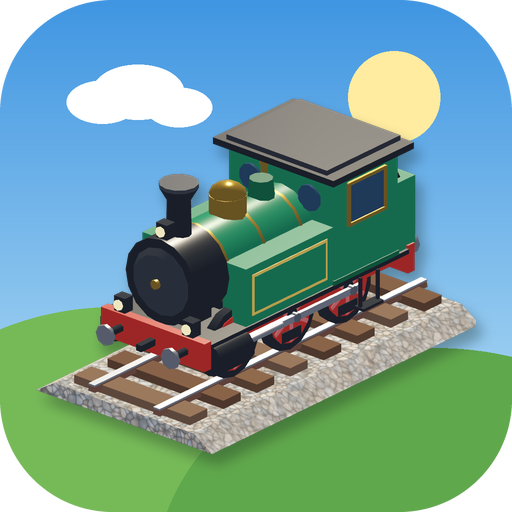

# Gleis frei! – Der Eisenbahn-Simulator

Isometrischer Eisenbahn-Simulator für **Android (arm64)**, gebaut mit **Godot 4.6**.
Du verlegst Gleise vom Start- zum Zielbahnhof und fährst die Strecke anschließend selbst mit der Dampflok ab.



## Spielprinzip

1. **Bauen** – Bahnhöfe auf die markierten Felder setzen, dann Gleise, Brücken, Bahnübergänge und Weichen verlegen.
2. **Fahren** – Mit Fahrregler, Bremse und Pfeife zum Zielbahnhof fahren und dort am Bahnsteig anhalten.
3. **Sterne** – Je günstiger die Strecke, desto mehr Sterne (Maßstab ist die günstigste mögliche Strecke).

| Level | Inhalt |
|---|---|
| 1 · Wiesental | Einzelne Häuser und Bäume, ein Bach, zwei markierte Bahnhofsflächen |
| 2 · Zwei Straßen | Mehr Häuser und zwei Straßen mit Autoverkehr – auf Straßen sind nur Bahnübergänge möglich |
| 3 · Kleinstadt | Dichte Bebauung, drei Straßen, breiter Fluss, knappes Budget |

### Bauteile

| Teil | Wo | Kosten |
|---|---|---|
| Gleis (Gerade/Kurve) | Wiese | 10 |
| Weiche | auf vorhandenem Gleis | +30 |
| Brücke | nur über Wasser | 80 |
| Bahnübergang | nur auf Straßen (nicht auf Kreuzungen) | 50 |
| Bahnhof | nur auf den markierten Feldern | 30 je Feld |

### Bedienung

- **Gleis ziehen:** mit dem Finger über die Felder fahren – Kurven entstehen von selbst, lose Enden schließen automatisch an.
- **Antippen:** setzt ein einzelnes Teil; erneutes Antippen dreht ein Gleis bzw. wechselt die Weichenform.
- **Zwei Finger:** Karte verschieben und zoomen. Mit dem Werkzeug „Ansicht“ verschiebt auch ein Finger.
- **Fahren:** Fahrregler rechts (oben vorwärts, unten rückwärts), Bremse und Pfeife links, Kamera-Taste wechselt
  zwischen Übersicht, Verfolger und Führerstand. Weichen stellst du über die Weichentaste oder durch Antippen.
- An Bahnübergängen schließen die Schranken, das Läutewerk bimmelt und die Autos warten.

## Projekt öffnen und bauen

- Mit Godot **4.6** den Ordner `eisenbahn-simulator` öffnen und starten (F5) – läuft auch am PC mit der Maus.
- Android-Export: Export-Vorlage „Android“ ist in `export_presets.cfg` eingerichtet (nur `arm64-v8a`, Renderer „Mobile“).
  Benötigt werden die Godot-Exportvorlagen, das Android-SDK und ein eigener Keystore:

  ```bash
  export GODOT_ANDROID_KEYSTORE_RELEASE_PATH=/pfad/zum/keystore
  export GODOT_ANDROID_KEYSTORE_RELEASE_USER=alias
  export GODOT_ANDROID_KEYSTORE_RELEASE_PASSWORD=passwort
  godot --headless --path . --export-release "Android" build/gleis-frei.apk
  ```

## Aufbau

| Pfad | Inhalt |
|---|---|
| `scripts/main.gd` | Spielablauf (Menü → Bauen → Fahren), Touch-Eingabe |
| `scripts/world.gd` | Spielfeld, Gelände, Bauregeln, Streckenprüfung, Kostenmaßstab |
| `scripts/levels.gd` | Level als ASCII-Karten – neue Level sind schnell ergänzt |
| `scripts/train.gd` | Zugbewegung auf dem Gleisnetz, Weichen, Dampf |
| `scripts/traffic.gd` | Autos, die an Schranken und Kreuzungen halten |
| `scripts/models.gd`, `track_models.gd`, `mesh_kit.gd` | prozedurale 3D-Modelle |
| `scripts/hud.gd`, `tbutton.gd`, `throttle.gd` | Oberfläche mit Mehrfinger-Bedienung |
| `scripts/audio.gd` | Musik und Geräusche |
| `tools/` | Generatoren für Texturen, Musik, Geräusche und Icon |

### Automatische Tests

`scripts/dev_test.gd` spielt das Spiel mit simulierten Touch-Eingaben durch
(Strecke bauen, per Autopilot fahren, Schranken, Weichen, Entgleisung):

```bash
godot --path . --fixed-fps 20 -- --test=all
godot --path . --fixed-fps 20 -- --test=switch
```

Quellen und Lizenzen: siehe [CREDITS.md](CREDITS.md).
